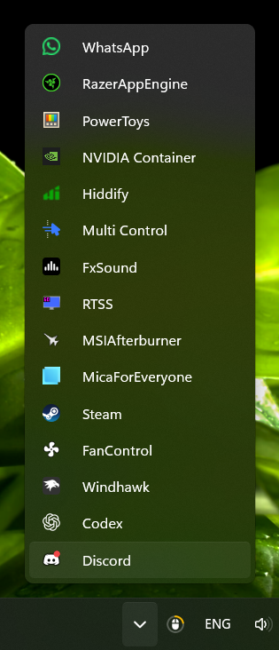

# TrayOverflowList

A Windhawk mod that displays the Windows 11 hidden tray icons as a vertical list, with icons on the left and application names on the right.

**Stable version: 0.1.8.8** · [Русская инструкция](docs/README.ru.md)

## Features

- Uses the original tray icon controls for clicks, context menus, and dragging.
- Keeps the native flyout background and derives width from the original grid measurements.
- Recalculates the width when the number of icons changes, including while startup applications load after a reboot.
- Trims long names with an ellipsis and provides vertical scrolling for long lists.
- Hides configurable technical name endings such as `.Root`, `.App`, and `.Runner`, without changing the Windows name source.
- Offers a row height setting. The right edge correction is fixed at 1 px.
- Uses collection, template, data-context, size, and scroll events with bounded layout follow-ups; width recalculation adds no timers.

## Compatibility

Tested by the user on Windows 11 26H2, build **26300.9457**, x64, with the Windows interface in English. Version 0.1.8.8 has been tested and confirmed working by the user on 2026-10-17.

This mod uses internal Windows tray interfaces. Compatibility with other builds and display languages has not been verified. It cannot be guaranteed after Windows updates.

## Install

1. Install and open [Windhawk](https://windhawk.net/).
2. Choose **Create a new mod** and replace the template with the complete contents of [`tray-overflow-list.wh.cpp`](tray-overflow-list.wh.cpp).
3. Click **Compile** and enable the mod if needed.
4. Open the hidden tray icons flyout.

To update an existing installation, replace its source with the same file and compile. Do not enable two copies of this mod at once.

## Settings

| Setting | Default | Description |
| --- | --- | --- |
| `hiddenNameSuffixes` | `.Root, .App, .Runner` | Comma-separated endings to remove from the end of labels, ignoring case. Leave empty to keep original names. |
| `rowHeight` | `33` | Row height in pixels. `0` keeps the native height. Custom values are applied from `20` upward. |

Settings changes reload the mod to restore native dimensions first. Reopen the flyout afterward. For example, `WhatsApp.Root` becomes `WhatsApp`, while `MicaForEveryone.App` becomes `MicaForEveryone`. Internal dots and unlisted endings are preserved. Consecutive listed endings are removed until none remain; the label is never reduced to an empty string.

## Troubleshooting

- **The panel remains narrow after reboot:** check that version 0.1.8.8 is enabled and that there is only one active copy. If it persists, report the Windows build and whether reopening the flyout changes the result.
- **Layout or highlight problems:** temporarily disable other mods that alter hidden tray icon geometry and compare the result.
- **Windows update breaks the mod:** disable it in Windhawk. Restart Explorer if the original panel layout does not return.

When reporting a problem, include the mod version, Windows build, display scaling, other tray layout mods, reproduction steps, and a screenshot if useful.

## Source and validation

The repository contains one release source file. Version 0.1.8.8 was tested and confirmed working by the user on 2026-10-17, including the review fixes for unload cleanup and event-driven layout updates. The default row height remains 33 px; technical suffix cleanup is configurable. Diagnostic builds and EXE metadata collection are not included.

The source passes the upstream PR validator and full DLL builds for x64 and ARM64 using the installed Windhawk toolchain. Native tests cover width calculations, bounded refreshes, callback lifetime, and subscriptions/restoration on real XAML controls in a separate process. The user confirmed operation inside Explorer; automated Explorer UI testing was not performed. ARM64 runtime behavior has not been verified.

See [CHANGELOG.md](docs/CHANGELOG.md) for the release history and [NOTICE.md](docs/NOTICE.md) for attribution.

## License

GPL-3.0-only. See [LICENSE](LICENSE). The source includes helpers derived from other GPL-licensed Windhawk tray mods; their existing attribution is retained.
